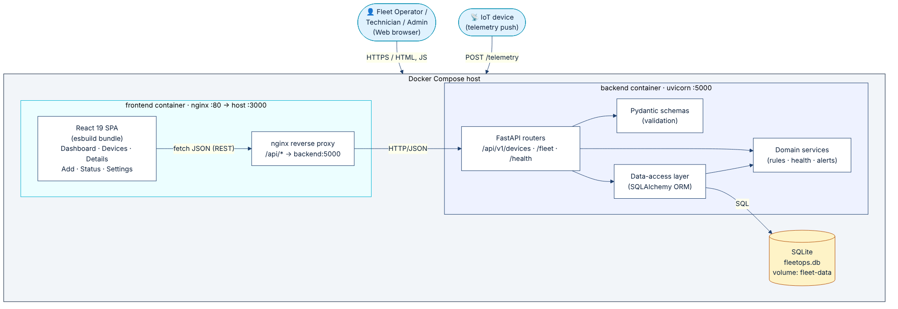

# Fleet Management System (FleetOps)

## 1. Vision Document
### Project Overview
FleetOps is a containerized full-stack application designed to monitor, track, and manage IoT device fleets in real time. It provides telemetry visualization and status controls for fleet operators.

### Problem It Solves
Managing distributed hardware fleets (drones, rovers, field sensors) without centralized telemetry leads to operational downtime, untracked device failures, and high maintenance overhead. FleetOps centralizes status tracking and deployment operations into a unified dashboard.

### Target Users (Personas)
* **Fleet Operators:** Monitor operational status, view online/offline metrics, and trigger emergency stops.
* **Maintenance Engineers:** Inspect device health, run diagnostics, and log repair tasks.
* **System Administrators:** Provision new devices, manage access permissions, and manage container deployments.

### Vision Statement
To provide a lightweight, cloud-native, and developer-friendly fleet orchestration platform that seamlessly scales from local Docker edge environments to enterprise deployments.

### Key Features / Goals
* **Real-time Fleet Monitoring:** View state across all connected devices.
* **CRUD Operations:** Dynamically register, update status, and decommission devices.
* **Containerized Architecture:** Fully dockerized frontend and backend services orchestrated via Docker Compose.
* **FastAPI Backend:** High-performance REST API with asynchronous handling.

### Success Metrics
* Sub-100ms API response time for telemetry retrieval.
* Zero downtime hot-reloading during local container development.
* 100% test coverage on critical REST endpoints.

### Assumptions & Constraints
* **Assumptions:** Network connectivity is available between devices and the backend service.
* **Constraints:** Must run smoothly on local development environments using Docker and Docker Compose.

---

## 2. Quick Start

### Run the whole stack with Docker Compose
```bash
git clone https://github.com/nachosftw/edgeops-fleet-manager.git
cd edgeops-fleet-manager
docker compose up --build
```
* Dashboard: http://localhost:3000
* API + Swagger UI: http://localhost:5000/docs

The frontend container (nginx) serves the React bundle and proxies `/api/*` to the backend container.
Device data is stored in SQLite on the `fleet-data` Docker volume, so it survives restarts.

### Local development without Docker
```bash
# terminal 1 – backend (http://localhost:5000)
cd backend
pip install -r requirements-dev.txt
uvicorn main:app --reload --port 5000

# terminal 2 – frontend with live rebuild (http://localhost:3000)
cd frontend
npm install
npm run dev
```

## 3. Testing

| Level | Tool | Command |
|---|---|---|
| Unit (domain rules) | pytest | `cd backend && pytest -m unit` |
| Integration (API + DB) | pytest + FastAPI TestClient | `cd backend && pytest -m integration` |
| Regression (pinned defects) | pytest | `cd backend && pytest -m regression` |
| Coverage | pytest-cov | `cd backend && pytest --cov` |
| Mutation | mutmut | `cd backend && mutmut run && mutmut results` |
| Frontend unit | node:test | `cd frontend && npm test` |
| End-to-end (browser) | Playwright | `cd frontend && npx playwright test` |

`make help` lists the same commands. GitHub Actions (`.github/workflows/ci.yml`) runs all of them on every push and pull request.

## 4. Version Management

* **Branching model:** Git Flow. `main` holds releases, `develop` is the integration branch, and work happens on `feature/*` branches that are merged with `--no-ff`. Releases are cut from `release/*` branches.
* **Commits:** Conventional Commits (`feat:`, `fix:`, `test:`, `build:`, `ci:`, `docs:`).
* **Versions:** Semantic Versioning. The current version is in [`VERSION`](VERSION), and every release is tagged `vMAJOR.MINOR.PATCH`. See [`CHANGELOG.md`](CHANGELOG.md).

## 5. API (v1)

| Method | Route | Purpose |
|---|---|---|
| GET | `/api/v1/health` | Liveness probe |
| GET | `/api/v1/fleet/summary` | Totals, availability, average battery, alerts |
| GET | `/api/v1/devices?status=&type=&search=` | List or filter devices |
| POST | `/api/v1/devices` | Register a device (201) |
| GET | `/api/v1/devices/{id}` | Device details and telemetry |
| PUT | `/api/v1/devices/{id}/status` | Change status with a reason note |
| POST | `/api/v1/devices/{id}/reboot` | Remote reboot |
| POST | `/api/v1/devices/{id}/telemetry` | Ingest a telemetry reading |
| GET | `/api/v1/devices/{id}/history` | Audit trail |
| DELETE | `/api/v1/devices/{id}` | Remove a device (204) |

## 6. MoSCoW Prioritization
* **Must Have (Essential for MVP):** View Device List (US 01), Add New Device (US 02), Delete Device (US 03), Containerized Stack & Docker Compose (US 06, US 07, US 08)
* **Should Have (High Priority):** Filter Devices by Status (US 04), Device Detail View (US 05), Enable Hot-Reloading (US 09)
* **Could Have (Nice to Have):** Search Fleet (US 16), Device Geolocation Map (US 20), Battery Telemetry Monitoring (US 22)
* **Won't Have (Deferred for Future Releases):** Firmware Update Trigger (US 23), User Authentication (US 17)

## 7. Architecture


The v0.1 diagram from Review 1 is kept at [`docs/rev1.drawio.png`](docs/rev1.drawio.png).
